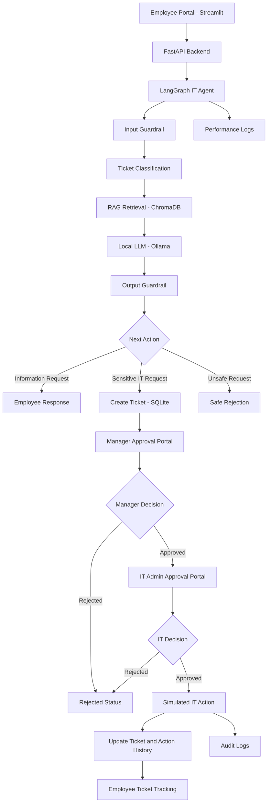

# TelecomCare-AI – System Architecture

## 1. Overview

TelecomCare-AI is an Agentic AI-based IT Ticket Automation System designed to automate employee IT support requests.

The system uses AI-based ticket classification, Retrieval-Augmented Generation (RAG), workflow orchestration, and human approval to manage IT requests.

It provides three interfaces:
- Employee Portal
- Manager Approval Portal
- IT Administrator Portal

## 2. Technology Stack

| Component | Technology |
|---|---|
| Programming Language | Python |
| Backend API | FastAPI |
| Frontend | Streamlit |
| Agent Orchestration | LangGraph |
| Local LLM | Ollama – Qwen 2.5 1.5B |
| Embedding Model | Sentence Transformers – all-MiniLM-L6-v2 |
| Vector Database | ChromaDB |
| Relational Database | SQLite |
| Evaluation | Scikit-learn |
| Logging | JSONL-based performance and audit logs |

## 3. High-Level Architecture

## 4. Ticket Processing Workflow

1. Employee submits an IT request through the Employee Portal.
2. Input guardrail checks the request for invalid or unsafe content.
3. The LangGraph agent classifies the request and determines its priority.
4. For troubleshooting questions, the RAG component retrieves relevant knowledge-base documents from ChromaDB.
5. The local Ollama model generates a response using the retrieved context.
6. The output guardrail checks the generated response.
7. Sensitive IT requests are converted into tickets and stored in SQLite.
8. Software installation and access requests require manager approval followed by IT approval.
9. After both approvals, the system executes a simulated IT action.
10. Ticket status and action history are updated in SQLite.

## 5. RAG Architecture

The RAG pipeline uses a local knowledge base containing IT troubleshooting articles.

Processing flow:
1. Employee submits a troubleshooting question.
2. Sentence Transformers converts the question into an embedding.
3. ChromaDB searches for semantically similar knowledge-base documents.
4. The top relevant documents are selected as context.
5. Ollama generates an answer using the retrieved context.
6. The system returns the answer and source document names.

## 6. Human Approval Workflow

The approval workflow uses two levels of approval for software installation and access requests.

**Manager Approval**
- Manager reviews the employee request.
- Manager can approve or reject it.
- Approved requests move to the IT approval stage.

**IT Approval**
- IT administrator reviews manager-approved requests.
- IT can approve or reject the request.
- After IT approval, the system performs a simulated action.

No real software installation or access provisioning is performed in this MVP.

## 7. Database Design

SQLite stores the operational workflow data.

Main tables:
- `tickets`: ticket details, employee information, category, priority and status.
- `approvals`: manager and IT approval decisions.
- `action_history`: records simulated IT actions and their outcomes.
- Password credential storage: stores salted password hashes for the demo password-reset workflow.

ChromaDB stores the embedded knowledge-base documents used for semantic retrieval.

## 8. Security and Guardrails

The MVP includes:
- Input validation and basic prompt-injection checks.
- Detection of selected sensitive information patterns.
- Output checks for unsafe credential requests and unsupported completion claims.
- Password hashing using PBKDF2-HMAC-SHA256 with a random salt.
- Approval checks before simulated sensitive IT actions.
- Audit logging of simulated IT actions.

These are basic MVP safeguards, not a complete production security implementation.

## 9. Monitoring and Performance

The system records:
- Retrieval latency.
- LLM response latency.
- Total processing time.
- Prompt and completion token counts when available.
- External API cost.
- Simulated IT action history.

Local model inference avoids external model API charges, although local hardware and electricity still have costs.

## 10. Current Limitations

- IT actions are simulated; no real infrastructure is modified.
- Password reset is a demonstration workflow and does not verify employee identity or change a real company account.
- Classification evaluation currently uses only 10 synthetic test cases.
- Guardrails use basic rule-based checks.
- The knowledge base contains a limited set of IT troubleshooting articles.

## 11. Future Enhancements

- Integrate enterprise identity verification and SSO.
- Connect to real IT service management platforms.
- Integrate secure endpoint and access-management tools.
- Expand the knowledge base and evaluation dataset.
- Add role-based authentication and authorization.
- Improve guardrails and monitoring for production deployment.